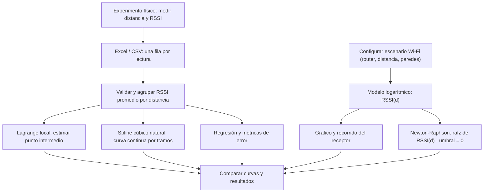
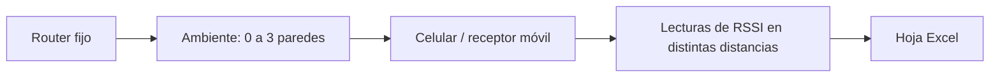

# SimuMath Wi-Fi — Avance del esquema de prototipo

**Curso:** Métodos Numéricos · UNMSM (FIEE)  
**Proyecto:** SimuMath — Simulación y análisis de propagación Wi-Fi  
**Integrantes:** Ismael y Anderson Fabián Gomez Quispe  
**Entrega:** 2 de noviembre de 2026 — avance de prototipo

> **Objetivo:** simular la potencia recibida (RSSI, dBm) a diferentes distancias de un router y contrastar el modelo con mediciones importadas desde Excel, aplicando tres métodos numéricos: interpolación de Lagrange, splines cúbicos y raíces de ecuaciones (Newton-Raphson).

## 1. Esquema funcional del prototipo

**Aclaración:** el método de raíces usa la ecuación del modelo teórico configurado; Lagrange y splines utilizan los promedios de datos importados (reales o de demostración). Se distinguen siempre los resultados simulados de las observaciones reales.

## 2. Pantallas del prototipo

| Sección | Elementos interactivos | Resultado observable |
|---|---|---|
| **01. Simular** | Banda de Wi-Fi, distancia (barra o arrastrando celular), paredes, parámetros avanzados | RSSI teórico, indicador de señal y recorrido animado |
| **02. Medir** | Descargar plantilla Excel, importar .xlsx/.csv, pegar datos o cargar demostración sintética | Tabla con número de lecturas, promedios y desviación estándar |
| **03. Analizar** | Distancia a interpolar por Lagrange, distancia para spline, umbral para Newton | Valores interpolados, comparación de métodos, curva spline y tabla de iteraciones de Newton |
| **04. Comparar** | Revisión de errores y exportación CSV | Modelo inicial vs. mediciones y comentarios sobre diferencias |

## 3. Relación entre los cálculos y un caso real

### 3.1 Interpolación local de Lagrange

Se elige una distancia **d** comprendida entre la menor y la mayor distancia medida. La página toma hasta **tres puntos próximos** (distancia, RSSI promedio) y calcula un polinomio que pasa por ellos. El resultado responde: *¿cuál sería el RSSI aproximadamente a una distancia que no medimos?*

### 3.2 Spline cúbico natural

Con al menos **tres distancias diferentes**, se construyen polinomios cúbicos por tramos para pasar por todos los puntos promedio. Se exige continuidad de la función, de su primera y segunda derivada y segunda derivada cero en los extremos. Se muestra el RSSI estimado en la distancia consultada y se traza la curva interpolada sobre la gráfica. Se compara su predicción con Lagrange local. **No se extrapola** fuera de las distancias registradas.

### 3.3 Raíces: Newton-Raphson

El modelo simplificado utilizado es:

`RSSI(d) = RSSI(d0) - 10·n·log10(d/d0) - L_paredes`

Para encontrar la distancia donde se alcanza un umbral seleccionado `U`, se plantea:

`f(d) = RSSI(d) - U = 0`

La iteración de Newton-Raphson es:

`d_(k+1) = d_k - f(d_k) / f'(d_k)`

con `f'(d) = -10·n / (d·ln(10))`.

La plataforma muestra distancia aproximada, residuo `f(d)` e **historial de iteraciones**. La raíz corresponde al modelo, **no** garantiza velocidad, conectividad ni alcance real.

## 4. Diagrama simplificado del escenario físico

Para medir: mantener fijo el router y la banda, marcar distancias, registrar **3 a 5 lecturas por distancia** desde una herramienta compatible y anotar observaciones (paredes, obstáculos, interferencia). El navegador no mide directamente el RSSI; los datos reales se registran fuera de la web y se importan.

## 5. Pruebas previstas para la demostración

1. **Sin datos:** la simulación funciona, pero interpolación y splines solicitan cargar observaciones.
2. **Con datos de ejemplo:** pulsar «Probar con datos de demostración» y comprobar las tablas y curvas. Estos datos están marcados como **sintéticos**.
3. **Lagrange:** seleccionar una distancia intermedia; la plataforma devuelve el RSSI estimado y los nodos usados.
4. **Spline:** elegir la misma distancia; observar el resultado, su comparación con Lagrange y la curva azul en el gráfico.
5. **Newton-Raphson:** elegir umbral de, por ejemplo, **−70 dBm**; verificar distancia, residuo y tabla de iteraciones.
6. **Datos Excel reales:** sustituir la demostración por lecturas tomadas en el experimento y repetir los cálculos.
7. **Validación:** confirmar que el spline pasa por cada dato promedio, que no extrapola y que el residuo de la raíz converge hacia cero.

## 6. Estado y alcance del avance

- [x] Interfaz web funcional con simulación Wi-Fi.
- [x] Receptor arrastrable y recorrido automático.
- [x] Importación de Excel / CSV, tabla de lecturas y datos de demostración.
- [x] Interpolación de Lagrange.
- [x] Spline cúbico natural.
- [x] Raíces mediante Newton-Raphson con historial de iteraciones.
- [x] Gráfica integrada y explicación de cada método.
- [ ] Campaña de mediciones reales en un entorno controlado (requiere datos de campo del equipo).
- [ ] Validación final y discusión cuantitativa con mediciones reales.

**Plataforma:** https://ismaelsvm.github.io/PROYECTO-FINAL-METODOS-NUMERICOS/  
**Repositorio:** https://github.com/ismaelsvm/PROYECTO-FINAL-METODOS-NUMERICOS

*Nota: este es un avance de prototipo. Los valores de demostración son sintéticos; los parámetros de simulación son ajustables y su correspondencia física debe contrastarse en el experimento.*
